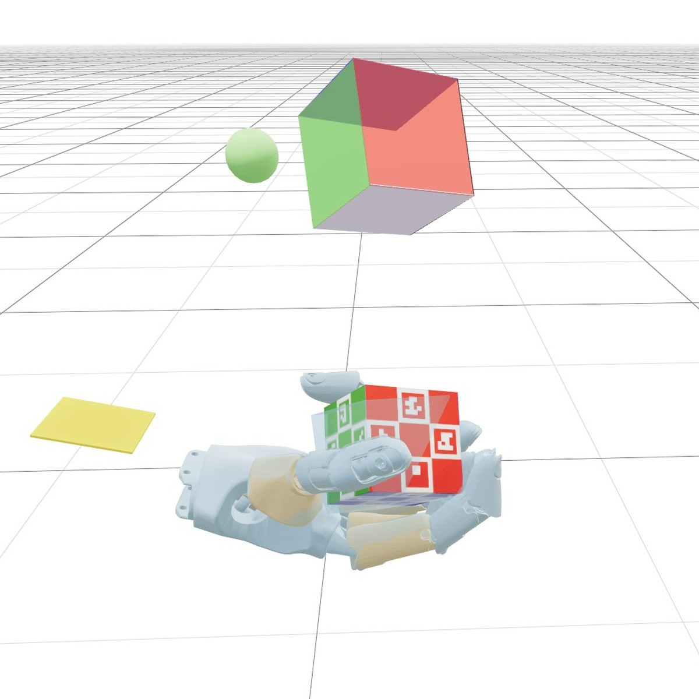
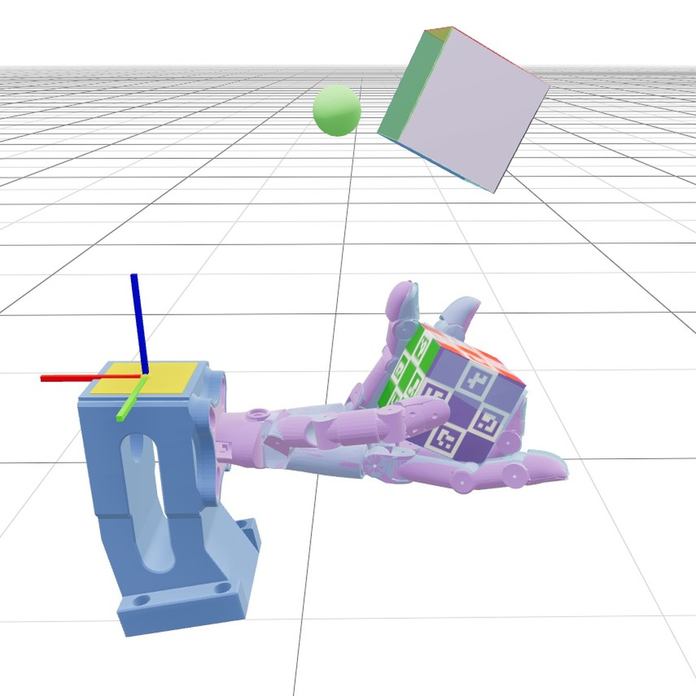
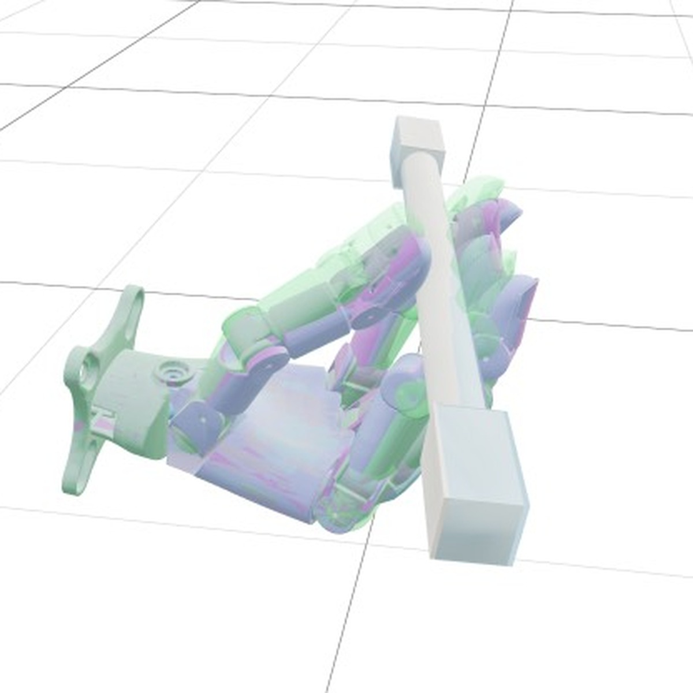

# Dex SuperMimic

[](LICENSE)
[](https://www.python.org/)
[](https://pytorch.org/)
[](#requirements)
[](https://docs.astral.sh/uv/)

> A world-model adaptation of [SuperMimic](https://supermimic.github.io/) for Wuji dexterous hands: train and visualize in-hand cube reorientation and reference-tracking pen spinning with the same imagination-based policy pipeline.

Dex SuperMimic combines a learned multi-step world model with actor-critic training in imagination. It uses [mjlab](https://github.com/mujocolab/mjlab) and [MuJoCo Warp](https://github.com/google-deepmind/mujoco_warp) for massively parallel GPU simulation, and packages the right Wuji Hand 1 / Hand 2 assets so installation does not require a Git submodule checkout.

## Demos

| Wuji Hand 1 · Cube Reorientation | Wuji Hand 2 · Cube Reorientation | Wuji Hand 2 · Pen Spin |
| :---: | :---: | :---: |
| <a href="docs/demos/hand1_reorient.jpg"></a> | <a href="docs/demos/hand2_reorient.jpg"></a> | <a href="docs/demos/hand2_pen_spin.jpg"></a> |

## Contents

- [Overview](#overview)
- [Requirements](#requirements)
- [Installation](#installation)
- [Tasks](#tasks)
- [Training](#training)
- [Playing and Evaluation](#playing-and-evaluation)
- [Pretrained Checkpoint](#pretrained-checkpoint)
- [Project Structure](#project-structure)
- [Testing](#testing)
- [Troubleshooting](#troubleshooting)
- [Acknowledgments](#acknowledgments)
- [License](#license)

## Overview

The project retains SuperMimic's three-phase idea:

1. collect short real-simulator rollouts into a replay buffer;
2. train a recurrent-style, multi-step world model on mixed normal and failure transitions;
3. optimize the policy and critic along imagined rollouts, periodically refreshing the buffer from the real simulator.

The implementation is task-aware: cube reorientation uses command/goal observations, an absolute EMA controller, contact and cage rewards, and a translucent world-model ghost in Viser. Pen spin tracks a packaged motion reference, uses a reference-plus-residual controller, and exposes the standard viewer without the cube-specific ghost overlay.

The Wuji hands, cube, and ArUCo-tagged pen are bundled under permissive licenses. The third-party Wuji MJLab checkout in `thirdparty/` is retained as a porting reference and is not installed by `uv sync`.

## Requirements

- Linux x86_64 with an NVIDIA GPU is required for training and playback. CUDA 12.8 is tested; Blackwell/RTX 50-series GPUs are supported by MuJoCo Warp.
- macOS arm64 can install and import the package, but training intentionally rejects non-CUDA devices.
- Python 3.10–3.13 is selected automatically by `uv`.
- At least one CUDA-capable GPU with enough memory for the requested parallel environment count. `--num-envs 1024` is the default starting point.
- Disk space for the virtual environment, Wuji meshes, pen-spin motion catalog, checkpoints, and TensorBoard events.

## Installation

Install [uv](https://docs.astral.sh/uv/getting-started/installation/) if it is not already available:

```bash
curl -LsSf https://astral.sh/uv/install.sh | sh
source "$HOME/.local/bin/env"
```

Clone this repository and install the dependencies:

```bash
git clone https://github.com/CumulusAlpha/Dex-Supermimic.git
cd Dex-Supermimic
uv sync
```

`uv sync` creates `.venv/`, resolves the locked training environment, installs the `dex-supermimic-train` and `dex-supermimic-play` entry points, and installs the local `wuji-description` asset package. No dataset download is needed for cube reorientation. Pen-spin setup is described in [Tasks](#tasks).

For a quick import and CLI check:

```bash
uv run python -c "import dex_supermimic, mjlab, mujoco, warp; print('imports ok')"
uv run dex-supermimic-train --help
```

## Tasks

| Task | Hand | Control rate | Data | Log directory |
|---|---|---:|---|---|
| `hand1-reorient` | Wuji Hand 1 (right) | 20 or 50 Hz | Bundled cube; no external dataset | `logs/dex_supermimic/hand1-reorient/<timestamp>` |
| `hand2-reorient` | Wuji Hand 2 (right) | 20 or 50 Hz | Bundled cube; no external dataset | `logs/dex_supermimic/<timestamp>` |
| `hand2-pen-spin` | Wuji Hand 2 (right) | 50 Hz only | Downloaded motion clips plus packaged recipe | `logs/dex_supermimic/hand2-pen-spin/<timestamp>` |

Checkpoints record the task, control rate, joint order, observation layout, and reference fingerprint. Playback chooses the environment automatically. Checkpoints cannot be resumed or used as world-model initialization across different hands or incompatible task layouts.

### Cube reorientation

Wuji Hand 1 and Wuji Hand 2 rotate a goal-labeled cube in-hand. Both tasks use the same SuperMimic runner. Hand 1 retains its upstream soft thumb pad, initial grasp, wrist tag frame, contact sensors, and palm-cage axis. Hand 2 is the default task.

### Pen spinning

Pen spin performs reference-based, multi-axis pen tracking with Wuji Hand 2. The five packaged recipes are:

```text
src/dex_supermimic/tasks/pen_spin/data/recipe/
├── 01_single_axis.json
├── 02_continuous_single_axis.json
├── 03_continuous_multi_axis.json        # default
├── 04_stable_grasp_rotation.json
└── 05_multi_axis_two_rotations.json
```

Detailed observation, controller, reward, and validation notes are available in:

- [Hand 1 cube reorientation](src/dex_supermimic/rl/dex_supermimic/setting_hand1_reorient.md)
- [Hand 2 cube reorientation](src/dex_supermimic/rl/dex_supermimic/setting_hand2_reorient.md)
- [Hand 2 pen spin](src/dex_supermimic/rl/dex_supermimic/setting_hand2_pen_spin.md)

## Training

Run from the repository root. The first launch may spend extra time compiling Warp and imagination kernels.

**Wuji Hand 1 cube reorientation**

```bash
uv run dex-supermimic-train --task hand1-reorient --num-envs 1024 --device cuda:0
```

**Wuji Hand 2 cube reorientation (default task)**

```bash
uv run dex-supermimic-train --task hand2-reorient --num-envs 1024 --device cuda:0
```

For cube reorientation, add `--control-hz 20` or `--control-hz 50` to choose the control rate (50 Hz is the default).

**Wuji Hand 2 pen spinning**

Download the upstream motion catalog, then train:

```bash
uv run python -m dex_supermimic.tasks.pen_spin.tooling.download
uv run dex-supermimic-train --task hand2-pen-spin --num-envs 1024 --device cuda:0
```

Select a different recipe or an external clip catalog with:

```bash
uv run dex-supermimic-train --task hand2-pen-spin \
  --recipe-path src/dex_supermimic/tasks/pen_spin/data/recipe/01_single_axis.json \
  --clips-root /path/to/clips
```

Pen spin requires `--control-hz 50`. Its clip downloader verifies clip hashes before reporting success.

### Useful training options

| Option | Meaning |
|---|---|
| `--num-envs` | Number of parallel simulator environments. All tasks default to `1024`. |
| `--device` | CUDA device, such as `cuda:0`. |
| `--control-hz` | Simulator control rate: `20` or `50`; pen spin requires `50`. |
| `--max-iterations` | Training iterations and final-checkpoint iteration. All tasks default to `8000`. |
| `--checkpoint` | Resume a compatible full training state. |
| `--model-checkpoint` | Initialize the world model only from another compatible run. |
| `--logger` | Metric backend: `tensorboard` (all-task default), `wandb`, or `none`. |
| `--save-interval` | Iterations between intermediate `model_<it>.pt` checkpoints. |
| `--no-compile` / `--no-compile-policy` | Disable simulator or imagination compilation to reduce startup time. |
| `--profile` | Log cumulative collection, world-model, and policy wall time. |

Run `uv run dex-supermimic-train --help` for the full list.

## Playing and Evaluation

Viser playback uses one environment and runs until interrupted. Open the URL printed in the terminal.

```bash
uv run dex-supermimic-play \
  --checkpoint logs/dex_supermimic/hand1-reorient/<timestamp>/model_final.pt
```

Useful options:

```bash
# Limit playback to 2,000 control steps
uv run dex-supermimic-play --checkpoint <checkpoint.pt> --steps 2000

# Native MuJoCo-style viewer
uv run dex-supermimic-play --checkpoint <checkpoint.pt> --no-viser --viewer --steps 2000

# Change world-model reseeding interval and ghost opacity in Viser
uv run dex-supermimic-play --checkpoint <checkpoint.pt> --wm-horizon 32 --wm-opacity 0.5

# Export an ONNX policy and matching deployment metadata
uv run dex-supermimic-play --checkpoint <checkpoint.pt> --export-onnx exports/policy.onnx
```

For cube reorientation, the light-blue hand/object meshes show the world-model prediction. The real and predicted scene-tree branches can be toggled independently in Viser. Pen spin uses the standard viewer; the cube-specific ghost overlay is omitted.

Inspect TensorBoard curves with:

```bash
uv run tensorboard --logdir logs/dex_supermimic
```

## Pretrained Checkpoint

A Hand 1 cube-reorientation checkpoint is distributed separately as a GitHub Release attachment:

```bash
mkdir -p logs/dex_supermimic/pretrained
curl -fL --retry 3 \
  https://github.com/CumulusAlpha/Dex-Supermimic/releases/download/pretrained-wuji-v1/model_8000.pt \
  -o logs/dex_supermimic/pretrained/model_8000.pt

uv run dex-supermimic-play \
  --checkpoint logs/dex_supermimic/pretrained/model_8000.pt
```

The `logs/` directory is Git-ignored, so the checkpoint remains separate from the source checkout. A converged Hand 1 policy and success-rate reproduction have not yet been fully validated; a small training/resume/playback smoke run has passed.

## Project Structure

```text
.
├── packages/wuji-description/       # Pinned Wuji Hand 1/2 MJCF and meshes
├── src/dex_supermimic/
│   ├── assets/                      # Cube, pen, and resource loading
│   ├── rl/dex_supermimic/           # SuperMimic runner, world model, replay buffer,
│   │                                # policy/critic training, Viser playback
│   └── tasks/
│       ├── dex_reorient/            # Cube task, rewards, observations, events
│       └── pen_spin/                # Pen task, recipes, motion-clip tooling
├── logs/                            # Git-ignored TensorBoard and checkpoints
├── thirdparty/wuji-mjlab/           # Optional local porting reference; not installed
├── pyproject.toml                   # Package metadata, dependencies, and CLI entry points
└── uv.lock                          # Locked Python environment
```

## Testing

The task-selection, packaged-model, and CUDA simulator checks are packaged with the source tree:

```bash
uv run python -m unittest discover -s tests/dex_supermimic -v
```

MuJoCo Warp CUDA checks are skipped automatically when CUDA is unavailable. They cover observation reconstruction, differentiable fingertip kinematics, cage faces, and rewards independent of stale body kinematics. Pen spin has passed a small GPU training/resume smoke test; convergence has not yet been validated.

## Troubleshooting

- **Training says a CUDA GPU is required.** Training and playback intentionally require `cuda:*`. Use a CUDA machine and pass `--device cuda:0` or another valid CUDA device.
- **First startup is slow.** Warp and imagination compilation can take considerable time. For iterative debugging, try `--no-compile-policy` or `--no-compile`; retain compilation for final performance runs.
- **Out of GPU memory.** Reduce `--num-envs`, `--wm-batch`, or `--pi-batch`. Intermediate checkpoints let you continue from the last compatible state with `--checkpoint`.
- **Checkpoint mismatch.** Full resume and world-model-only initialization require matching task, hand, control rate, joint order, and observation/reference layouts.
- **Pen-spin rate error.** Pen spin requires 50 Hz reference playback. Do not pass `--control-hz 20` for `hand2-pen-spin`.
- **Headless Viser rendering.** Playback sets `MUJOCO_GL=egl` by default when Viser is enabled. If EGL is unavailable, install/configure an appropriate EGL driver or run on a machine with working GPU rendering.

## Acknowledgments

We thank the [SuperMimic](https://supermimic.github.io/) authors for the original method.

We thank the authors and contributors of the following repositories:

1. [InstinctMJ](https://github.com/project-instinct/InstinctMJ) — the foundation of this repository and its mjlab-based simulation framework.
2. [Wuji MJLab](https://github.com/wuji-technology/wuji-mjlab) — the Wuji hand cube-reorientation and pen-spin task implementations.
3. [supermimic_vibed](https://github.com/zita-ch/supermimic_vibed) — the SuperMimic reproduction.

## License

The task adaptations are released under the Apache License, Version 2.0. See [LICENSE](src/dex_supermimic/tasks/dex_reorient/LICENSE), [NOTICE](src/dex_supermimic/tasks/dex_reorient/NOTICE), and the corresponding files under [pen spin](src/dex_supermimic/tasks/pen_spin/NOTICE) for third-party attribution. The bundled Wuji descriptions retain their upstream MIT license in [`packages/wuji-description/LICENSE`](packages/wuji-description/LICENSE).
