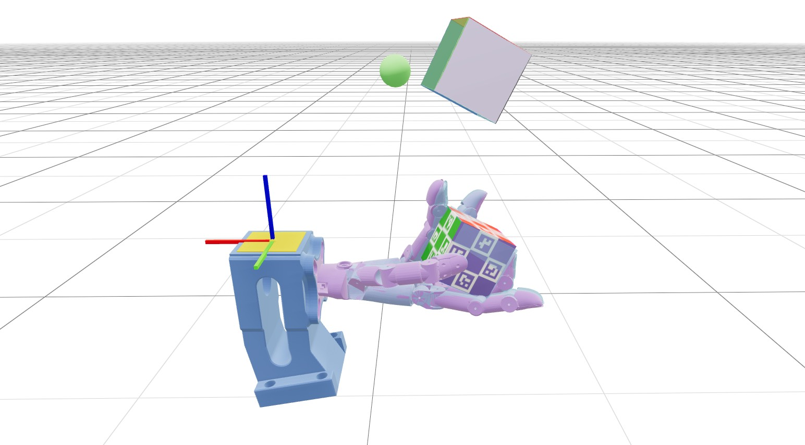

# Dex SuperMimic



This repository reproduces [SuperMimic](https://supermimic.github.io/) on dexterous hands, adapting its world-model-based training approach to in-hand cube reorientation with Wuji Hand 1 and Wuji Hand 2, and reference-based pen spinning with Wuji Hand 2. It is built on mjlab and MuJoCo Warp.

## Download and Installation

Install [uv](https://docs.astral.sh/uv/getting-started/installation/) if it is not already available:

```bash
curl -LsSf https://astral.sh/uv/install.sh | sh
source "$HOME/.local/bin/env"
```

Clone this repository and install the dependencies:

```bash
git clone https://github.com/CumulusAlpha/Dex-Supermimic.git
cd Dex-Supermimic
uv sync
```

`uv` creates the local Python environment and installs the project dependencies, including the bundled Wuji hand models and meshes. Cube reorientation needs no separate dataset. Pen spinning uses the motion download described below.

## Training

Run from the repository root:

```bash
uv run dex-supermimic-train --num-envs 1024 --device cuda:0
```

This launches 1024 parallel environments on the first CUDA GPU. Training logs and checkpoints are saved to `logs/dex_supermimic/<timestamp>/`.

Wuji Hand 1 cube reorientation uses the same SuperMimic world-model and
imagination training pipeline, with the original Hand 1 model, soft thumb pad,
initial grasp, wrist-tag frame, contact sensors, and palm cage axis:

```bash
uv run dex-supermimic-train --task hand1-reorient --num-envs 1024 --device cuda:0
```

Hand 1 runs are saved to `logs/dex_supermimic/hand1-reorient/<timestamp>/`.
Both hands support `--control-hz 20` and `--control-hz 50` (default).
Playback and evaluation select the hand from the checkpoint automatically:

```bash
uv run dex-supermimic-play --checkpoint logs/dex_supermimic/hand1-reorient/<timestamp>/model_final.pt
```

The default task remains `hand2-reorient`; older checkpoints without a task
field are read as Hand 2. Checkpoints cannot be resumed or used for world-model
initialization across different hands. Hand 1 assets are bundled by `uv sync`;
the `thirdparty/wuji-mjlab` checkout is only a porting reference.

Run the task-selection and packaged-model checks, plus CUDA simulator checks
for both hands at both frequencies, with:

```bash
uv run python -m unittest discover -s tests/dex_supermimic -v
```

CUDA checks cover observation reconstruction, differentiable fingertip
kinematics, cage faces, and rewards independent of stale body kinematics.
MuJoCo Warp simulator checks are skipped when CUDA is unavailable.
Hand 1 has passed a small training/resume/playback smoke run; a converged
Hand 1 policy and success-rate reproduction have not yet been validated.

Training logs locally with TensorBoard by default. To use Weights & Biases, append `--logger wandb`; to disable logging, append `--logger none`.

## Pen spinning (Hand 2)

Download the upstream motion catalog, then train with the same SuperMimic runner:

```bash
uv run python -m dex_supermimic.tasks.pen_spin.tooling.download
uv run dex-supermimic-train --task hand2-pen-spin --num-envs 1024 --device cuda:0
```

The default recipe is continuous multi-axis rotation. Select another of the five
packaged recipes with `--recipe-path src/dex_supermimic/tasks/pen_spin/data/recipe/01_single_axis.json`.
Use `--clips-root /path/to/clips` for an external catalog. Pen spin requires 50 Hz.
Logs are saved under `logs/dex_supermimic/hand2-pen-spin/<timestamp>/`.
Playback selects the task and recipe from its checkpoint:

```bash
uv run dex-supermimic-play --checkpoint logs/dex_supermimic/hand2-pen-spin/<timestamp>/model_final.pt
```

Pen spin supports the standard Viser viewer, native viewer and headless playback;
the cube-specific world-model ghost overlay is not used. The implementation has
passed a small GPU training/resume smoke test; convergence has not been validated.
See [the pen-spin recipe notes](src/dex_supermimic/rl/dex_supermimic/setting_hand2_pen_spin.md)
for observation/controller details, validation and imagination approximations.

## Visualization

Download [`model_8000.pt`](https://github.com/CumulusAlpha/Dex-Supermimic/releases/download/pretrained-wuji-v1/model_8000.pt) from the [pretrained checkpoint release](https://github.com/CumulusAlpha/Dex-Supermimic/releases/tag/pretrained-wuji-v1) and place it at `logs/dex_supermimic/pretrained/model_8000.pt`. From the repository root:

```bash
mkdir -p logs/dex_supermimic/pretrained
curl -fL --retry 3 \
  https://github.com/CumulusAlpha/Dex-Supermimic/releases/download/pretrained-wuji-v1/model_8000.pt \
  -o logs/dex_supermimic/pretrained/model_8000.pt
```

The pretrained checkpoint is distributed as a Release attachment and is downloaded separately from the source code. The `logs/` directory is ignored by Git.

From the repository root, load the pretrained checkpoint in the Viser web viewer:

```bash
uv run dex-supermimic-play \
  --checkpoint /home/motphys/supermimic-instinct/logs/dex_supermimic/hand1-reorient/2026-10-26_21-33-46/model_final.pt
```

Playback uses Viser and one environment by default and runs until you press `Ctrl+C` (`--steps 0` is the default). Open the viewer URL printed in the terminal in your browser. To limit playback, pass a positive control-step count such as `--steps 2000`. Replace the checkpoint path to view your own trained policy.

## Acknowledgments

We thank the [SuperMimic](https://supermimic.github.io/) authors for the original method.

We thank the authors and contributors of the following repositories:

1. [InstinctMJ](https://github.com/project-instinct/InstinctMJ) — the foundation of this repository and its mjlab-based simulation framework.
2. [Wuji MJLab](https://github.com/wuji-technology/wuji-mjlab) — the Wuji hand cube reorientation task and environment implementation.
3. [supermimic_vibed](https://github.com/zita-ch/supermimic_vibed) — the SuperMimic reproduction.
